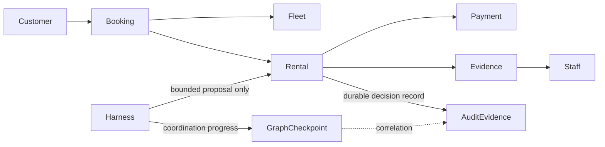

# Step 0: Decide Who Owns the Rental

Alex Morgan wants a compact car for a weekend. The repository already has a
story for his rental and a roadmap for building the system, but neither one
delivers a runnable booking flow. This chapter turns that destination into a
reviewable contract: for each consequential decision, identify who owns it,
what evidence is authoritative, and what the system does when that evidence is
missing or uncertain.

This is a design exercise, not an implementation walkthrough. There is no
application, graph, database, model, or runtime result to run. The diagrams and
scenarios below describe boundaries to preserve in later steps; they do not
claim those components exist.

## What this chapter establishes

By the end, you should be able to:

- Name the owner and decision authority for each important rental transition.
- Distinguish business records, workflow progress, temporary model context, and
  decision evidence.
- Explain why a model proposal, workflow checkpoint, or telemetry trace cannot
  authorize a charge, establish liability, or release an unsafe vehicle.
- Choose deterministic rules, authorized review, bounded model assistance, or a
  workflow engine according to the problem.
- Read acceptance targets as proposals, not as measured results.

### Starting point and prerequisites

The starting point for this chapter is the Step 0 blueprint merged to
`development` at `6bd4aefe59e82954f5b38ce099be315072e3ed60`. That snapshot
contains planning documents and the proposed scope; authorization to complete
the chapter followed. It contains no rental implementation. The empty
`development` root that preceded it was
`f5fecbac8a063b9b59bacb22e87ead17a144dcc7`.

You need only Git and a Markdown reader to follow the chapter. There is no JDK,
Maven, Docker, kind cluster, database, model download, credential, or paid
inference prerequisite. Java 25 is the planned baseline for later code; it is
not a Step 0 dependency or compatibility result. No library or runtime version
matrix applies here.

## Start with decision ownership

The phrase “the AI handles the rental” hides the most important design
question: which facts and decisions belong to the business, and which work is
only assistance? Assign each fact to an owner before choosing agents or
services. These are logical boundaries, not a promise to deploy one service per
row.

| Boundary | Authoritative facts | Decision authority |
| --- | --- | --- |
| Booking | Request, quote, reservation status | Deterministic eligibility and versioned quote checks |
| Fleet | Capacity, holds, allocation, readiness | Atomic availability rules and authorized inspection or maintenance records |
| Rental | Agreement, pickup, active rental, return, billing facts | Verified prerequisites, accepted agreement, condition evidence, authorized assessments |
| Payment | Authorization, capture, release, refund, operation outcome | An explicitly authorized operation and the provider's outcome |
| Policy and evidence | Applicable policy versions and inspection provenance | Access-controlled, dated evidence; conflicts remain visible |
| Staff review | Review decisions within authenticated roles and limits | An authorized person acting on the evidence version presented |
| Lost property and disputes | Separate cases linked to the rental | Verified ownership/contact permission or an approved adjustment |
| Graph and harness | Coordination and bounded proposals | No authority to override domain owners; controls remain outside model decisions |

A model can summarize supplied condition records and propose questions for a
reviewer. It cannot decide that a payment succeeded, that a scratch is Alex's
responsibility, or that a vehicle is safe. Those outcomes depend on
authoritative records and deterministic rules or authorized people.

## Keep four kinds of state separate

The word “state” can refer to several different things. Mixing them creates
false recovery and audit claims.

| Kind | What it represents | What it cannot establish |
| --- | --- | --- |
| Business state | Authoritative rental, inventory, and payment facts | A model or graph cannot invent a committed outcome |
| Durable graph progress | Where coordination stopped and the references needed to continue | A checkpoint is not atomic with a remote payment or a complete audit log |
| Ephemeral context | Bounded information supplied for the current model task | It is not a business record or a reliable recovery mechanism |
| Decision evidence | The evidence versions, actor, concise grounds, and outcome for a consequential decision | Sampled telemetry alone is not durable decision evidence |

The later architecture is intended to keep those boundaries visible:



This is a conceptual boundary map, not a deployed topology. The dashed
correlation line does not make a graph checkpoint an audit record. Later
chapters must demonstrate how each owner persists its facts and how decision
evidence remains available when telemetry export is sampled or unavailable.

## Walk the happy path without giving the model authority

Follow Alex from search to the fleet handoff. At every transition, ask what
must already be true, who can establish it, and what should happen if its
outcome is unknown.

| Synthetic case | Prerequisites | Owner and authority | Versioned evidence references (illustrative slots) | Outcome or abstention | Future acceptance check |
| --- | --- | --- | --- | --- | --- |
| `S0-H-01` search/quote | Request interval and eligibility inputs are available | Booking applies deterministic eligibility/pricing; fleet owns capacity | `request:S0-H-01`; `eligibility-policy:<version>`; `pricing-policy:<version>`; `quote:<version>` | Return only an eligible quote based on the checked policy and capacity | Same request and policy versions produce the same quote; stale versions are rejected |
| `S0-H-02` hold/reservation | Quote is valid; requested interval is still available | Fleet owns the atomic hold; booking owns reservation status | `quote:S0-H-02:<version>`; `hold-operation:<stable-id>`; `hold-outcome:<version>` | Reservation refers to the hold; uncertain hold outcome is queried before retry | Competing requests cannot both commit the same capacity; a lost success response does not duplicate the hold |
| `S0-H-03` payment authorization | Reservation is valid and payment action is authorized | Payment owns the operation and provider outcome | `reservation:S0-H-03:<version>`; `payment-operation:<stable-id>`; `provider-outcome:<version>` | Record the known outcome; reconcile an unknown result without blindly resubmitting | Duplicate command and lost response resolve to one reconciled operation outcome |
| `S0-H-04` pickup | Identity/licence result, accepted terms, required deposit outcome, and ready assignment are authoritative | Rental checks prerequisites; fleet owns readiness; payment owns deposit outcome | `renter-check:S0-H-04:<version>`; `agreement:<version>`; `deposit-operation:<stable-id>`; `fleet-assignment:<version>` | Activate only after every prerequisite is satisfied; otherwise stop | Missing or negative prerequisite prevents activation; duplicate pickup does not repeat an effect |
| `S0-H-05` return/inspection | Vehicle is returned and inspection evidence is recorded | Rental records return; authorized staff assess condition | `return-record:S0-H-05:<version>`; `condition-inspection:<version>`; `prior-condition:<version>` | Preserve observations; abstain or refer conflicting/missing evidence for review | Incomplete or conflicting evidence cannot establish liability automatically |
| `S0-H-06` settlement/readiness | Billing facts have authorized approval; payment outcome is known; fleet inspection is complete | Rental owns billing facts; payment executes authorized operation; fleet owns readiness | `billing-facts:S0-H-06:<version>`; `approval:<evidence-version>`; `payment-operation:<stable-id>`; `readiness-inspection:<version>` | Reconcile an unknown payment; keep vehicle unavailable until fleet readiness passes | Changed evidence invalidates affected approval; unknown payment is not blindly retried; unresolved safety concern blocks availability |

The case IDs and evidence references below are synthetic placeholders for review;
they do not identify real records or establish that a record schema exists. The
intended sequence is:

```text
request -> quote -> capacity hold -> reservation -> authorized payment
        -> verified pickup -> recorded return -> reviewed billing facts
        -> authorized settlement -> independent fleet readiness decision
```

Step 0 defines the owners and questions. It does not implement the transitions,
guarantee their behavior, or measure their performance.

## Treat the ambiguous return as a separate business problem

Alex returns the car and leaves his cellphone on the back seat. Cleaning finds
a scratch on the driver's door. These are two different cases. Finding the
phone is not permission to contact Alex or disclose his information. Seeing the
scratch does not establish when it happened, who caused it, or whether Alex is
liable.

| Synthetic case | Prerequisites and versioned evidence references (illustrative slots) | Owner and authorized actor | Outcome or abstention | Prohibited inference | Future acceptance check |
| --- | --- | --- | --- | --- | --- |
| `S0-A-01` cellphone found | Synthetic return record and item-location record: `return:S0-A-01:<version>`, `found-item:<version>` | Lost-property owner; staff act only under verified ownership/contact process | Record a separate case; withhold disclosure/outreach if ownership or permission is unresolved | A tool result grants permission to disclose information or send a message | Wrong-owner lookup and missing/revoked consent do not expose customer data or trigger outreach |
| `S0-A-02` scratch observed | Return and condition records: `return:S0-A-02:<version>`, `condition-inspection:<version>`, `prior-condition:<version>` | Rental preserves evidence; authorized reviewer assesses it | Produce a typed proposal for review or abstain/refer when evidence conflicts | The observation alone proves timing, liability, or a charge amount | Conflicting or missing condition evidence cannot trigger an automatic liability decision or charge |
| `S0-A-03` safety concern unresolved | Inspection record and fleet readiness policy: `readiness-inspection:S0-A-03:<version>`, `readiness-policy:<version>` | Fleet owner or authorized inspector | Keep vehicle unavailable until authoritative readiness checks pass | A model summary or completed rental releases the vehicle | Readiness cannot become available until required authoritative checks pass |
| `S0-A-04` evidence changes after review | Existing approval and new evidence versions: `approval:S0-A-04:<prior-version>`, `condition-inspection:<new-version>` | Staff review owner re-evaluates under the authorized process | Revoke or reconsider the affected proposal/approval before a consequential action | An earlier approval automatically applies to new evidence | A changed evidence version prevents reuse of an affected approval without re-evaluation |

A bounded model may propose a summary or identify missing evidence. A reviewer
may request more evidence, and a later proposal may be clearer. Neither model
agreement nor repeated revision changes permissions, decides liability, or
authorizes an irreversible effect.

## Use the right mechanism for the decision

Not every problem benefits from an agent.

| Mechanism | Appropriate use in this rental | Boundary |
| --- | --- | --- |
| Deterministic rules | Eligibility, exact-decimal pricing, inventory constraints, legal transitions, payment permissions, safety gates | Rules need explicit ownership, versioning, and tests |
| Authorized human review | Uncertain liability, conflicting condition evidence, safety decisions within staff roles | Review must identify the actor and evidence version; approval is not permission to blindly replay an effect |
| Bounded model proposal | Summarize supplied records, identify evidence gaps, draft a typed assessment for review | The harness constrains context, tools, schemas, identity, and budgets; the model cannot grant itself authority |
| Workflow engine or graph | Coordinate waits, durable progress, and bounded work across owners | Coordination does not replace business ownership or make remote effects atomic |

LangGraph4j is the series' planned graph coordination library. Step 0 makes no
claim about its versions or capabilities. Before later chapters depend on
reducers, nested graphs, streaming, persistence, serialization, or resume, those
capabilities must be checked against the exact pinned artifacts. If a plain
workflow engine or deterministic code is a better fit, use that instead of
adding an agent for novelty.

## Failure exercise: stop at uncertainty

For each scenario, write down the prohibited inference, authoritative owner,
safe next action, retained evidence, and a future test. This chapter reasons
about these failures; it does not execute recovery.

| Failure | Do not infer | Safe path to design and test later |
| --- | --- | --- |
| Payment response is lost after submission | The payment failed, or it is safe to submit again | Payment queries the stable operation identity and reconciles the provider outcome before another action |
| Evidence changes after approval | The earlier decision still covers the new evidence | The owning reviewer/policy boundary detects the version change and requires re-evaluation |
| Retrieved or tool content contains malicious instructions | The content is trusted because it came from a search or MCP tool | Treat it as untrusted data; enforce allowlists, scope, schema, and policy outside the model |
| Telemetry export is dropped or sampled | No decision occurred, or telemetry is the only audit record | Preserve required decision evidence separately and link it to trace/span identifiers when available |

The future tests must cover lost responses, duplicate commands, changed evidence,
unauthorized access, malicious content, and telemetry failure. A design table is
not proof those tests pass.

## Proposed acceptance and benchmark worksheet

The Step 0 documentation target is complete coverage: both walkthroughs name
the owner, authority, evidence, and future acceptance check for each
consequential decision; no model is authorized to make those decisions; and
each listed failure has an explicit safe outcome. These are review criteria,
not measured results.

Runtime thresholds remain undecided. Before a runtime benchmark, choose a named
environment and workload, record versions, and agree warm-up and repetition
rules. The worksheet should capture:

- Latency percentiles, throughput, and concurrency.
- Recovery time and behavior across restart or lost responses.
- Cost and turn/token/time budgets.
- Task quality, false approvals, and abstention.
- Whether each result is deterministic or stochastic and, for stochastic
  evaluation, the run count and tolerance.

Do not report a target as achieved until the relevant implementation and check
exist. Hardware, provider/model selection, synthetic policy/tool contracts, and
numerical success thresholds remain open decisions in the [series
plan](../../plan.md#open-decisions).

## What Step 0 does not deliver

There is no runnable application, API, database schema, graph, prompt, policy
engine, deployment resource, MCP server, telemetry backend, or payment
integration. There are no unit, Testcontainers, kind, Compose, live-model, or
performance results. This chapter does not establish legal rules, a liability
decision, or a runtime compatibility matrix. Its examples use no real customer
data, credentials, payment details, or private model reasoning.

To review the contract, compare the two walkthrough tables with the owner
boundaries, then check that every failure row has a future acceptance check.
That exercise establishes documentation coverage only. It cannot establish
runtime safety, resilience, privacy, latency, or correctness.

## Handoff

Step 0 defines what the later system must preserve, not how a running system
behaves. The next planned increment is Step 1: a reproducible Quarkus/Java 25
booking baseline with PostgreSQL, deterministic fixtures and clock, tests, and
local deployment paths. Step 1 needs its own approved blueprint and verified
compatibility evidence. Do not infer that it is implemented or begin it until
those gates are satisfied.
